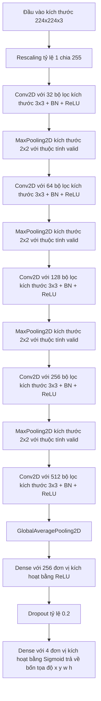

# Dự án Định vị Bàn tay trên Bộ dữ liệu HaGRID Hand Gesture Recognition Image Dataset

Dự án này xây dựng một mô hình mạng nơ-ron tích chập CNN tùy chỉnh sử dụng TensorFlow/Keras để định vị bàn tay từ hình ảnh đầu vào. Mô hình dự đoán tọa độ hộp giới hạn $[x, y, w, h]$ chuẩn hóa của bàn tay dưới dạng một bài toán hồi quy.

---

## 📌 Tổng quan dự án

- **Bài toán:** Hồi quy tọa độ hộp giới hạn bàn tay từ ảnh màu.
- **Bộ dữ liệu:** HaGRID được thu nhỏ về độ phân giải $224 \times 224$ pixel tại địa chỉ https://github.com/hasty-ai/hagrid
- **Đầu vào:** Ảnh màu RGB kích thước $224 \times 224 \times 3$.
- **Đầu ra:** Tọa độ hộp giới hạn $[x, y, w, h]$ chuẩn hóa từ 0 đến 1 chứa bàn tay:
  - $x, y$: Tọa độ góc trên bên trái của hộp giới hạn.
  - $w, h$: Chiều rộng và chiều cao của hộp giới hạn.

---

## 📊 Bộ dữ liệu & Tiền xử lý

### 1. Phân bố dữ liệu gốc
Bộ dữ liệu gồm **65,535 ảnh** phân bố trên **9 lớp cử chỉ tay**:

| Cử chỉ tay | Số lượng ảnh |
| :--- | :--- |
| **mute** | 8,016 ảnh |
| **ok** | 7,754 ảnh |
| **like** | 7,752 ảnh |
| **four** | 7,487 ảnh |
| **fist** | 7,232 ảnh |
| **call** | 7,021 ảnh |
| **palm** | 7,003 ảnh |
| **one** | 6,768 ảnh |
| **peace_inverted** | 6,502 ảnh |

*Nhận xét:* Số lượng ảnh giữa các lớp khá cân bằng, giúp mô hình không bị thiên lệch trong quá trình huấn luyện.

### 2. Phân chia tập dữ liệu mới
Dữ liệu sau khi lọc được chia lại một cách ngẫu nhiên sử dụng seed bằng 42 để đảm bảo tính nhất quán:
- **Tập huấn luyện train.json:** 42,442 ảnh, chiếm khoảng 65 phần trăm.
- **Tập kiểm định val.json:** 9,794 ảnh, chiếm khoảng 15 phần trăm.
- **Tập kiểm tra test.json:** 13,058 ảnh, chiếm khoảng 20 phần trăm.

### 3. Tối ưu hóa hiệu năng nạp dữ liệu tf.data Pipeline
Để tăng tốc tối đa tốc độ nạp dữ liệu lên GPU và tránh hiện tượng nghẽn cổ chai ở CPU, dự án áp dụng các kỹ thuật:
- **Kích thước lô BATCH_SIZE bằng 32:** Đảm bảo cân bằng giữa tốc độ tính toán GPU và dung lượng bộ nhớ VRAM.
- **Số lượng luồng NUM_WORKERS bằng 8:** Sử dụng 8 luồng CPU song song để đọc và giải mã ảnh.
- **Kỹ thuật lưu bộ nhớ đệm cache:** Lưu trữ tạm thời các ảnh đã xử lý để tránh đọc lặp lại ở các chu kỳ sau.
- **Kỹ thuật trộn shuffle với bộ đệm 1000:** Trộn ngẫu nhiên dữ liệu với bộ đệm 1000 phần tử nhằm hạn chế mô hình học thuộc lòng thứ tự ảnh.
- **Kỹ thuật prefetch:** Chuẩn bị trước các lô dữ liệu tiếp theo trên CPU trong khi GPU đang xử lý lô hiện tại.

---

## 🏗️ Kiến trúc mô hình CNN

Mô hình được xây dựng dạng tuần tự Sequential tối ưu cho bài toán hồi quy định vị:



### Các điểm cải tiến nổi bật:
- **Chuẩn hóa luồng dữ liệu:** Thứ tự Conv2D, BatchNormalization và Activation ReLU giúp phân phối dữ liệu đầu vào của hàm phi tuyến luôn ổn định.
- **Khởi tạo trọng số chuyên dụng:** Sử dụng bộ khởi tạo he_normal cho tất cả các lớp tích chập giúp ổn định biên độ đạo hàm khi truyền qua các lớp sâu.
- **Tiết kiệm tài nguyên:** Tắt bias bằng cách đặt thuộc tính use_bias thành False ở tất cả các lớp tích chập đứng trước lớp chuẩn hóa BatchNormalization để giảm tham số thừa.
- **Thay thế Flatten bằng GlobalAveragePooling2D:** Giảm 99 phần trăm số lượng tham số kết nối tới lớp Dense, chống quá khớp và tăng tốc độ hội tụ.
- **Lớp đầu ra Sigmoid:** Sử dụng hàm kích hoạt sigmoid cho lớp Dense cuối cùng có 4 neuron để đảm bảo tọa độ đầu ra luôn nằm trong khoảng từ 0 đến 1.

---

## ⚙️ Cấu hình huấn luyện

- **Thuật toán tối ưu Optimizer:** Adam với tốc độ học learning_rate bằng 0.0001, hệ số beta_1 bằng 0.9 và clipnorm bằng 1.0 nhằm giới hạn chuẩn L2 của đạo hàm để chống bùng nổ gradient.
- **Hàm mất mát Loss function:** MSE giúp phạt nặng các sai số lớn để mô hình nhanh chóng khớp khung hộp giới hạn.
- **Chỉ số đánh giá Metric:** MAE để đo lường trực quan khoảng cách sai số thực tế theo tỷ lệ ảnh.
- **Cơ chế tự động:**
  - **EarlyStopping**: Dừng huấn luyện sớm nếu độ mất mát trên tập kiểm định val_loss không cải thiện liên tục sau 10 chu kỳ, đồng thời khôi phục lại trọng số tốt nhất bằng cách thiết lập restore_best_weights thành True.
  - **ReduceLROnPlateau**: Tự động giảm tốc độ học đi một nửa bằng cách nhân với hệ số 0.5 nếu val_loss không giảm sau 3 chu kỳ liên tiếp.

---

## 📈 Kết quả huấn luyện & Đánh giá

Mô hình được huấn luyện trên GPU CUDA và đạt được kết quả ấn tượng sau quá trình tối ưu hóa:

- **Độ mất mát trên tập kiểm tra Test Loss MSE:** 0.0057
- **Sai số tuyệt đối trung bình trên tập kiểm tra Test MAE:** 0.0490

> 💡 **Ý nghĩa thực tế:** Với Test MAE đạt 0.0490, điều này có nghĩa là các cạnh của hộp giới hạn dự đoán trung bình chỉ bị lệch khoảng 4.9 phần trăm so với kích thước gốc của hình ảnh, tương đương khoảng 11 pixel trên độ phân giải $224 \times 224$.

---

## 📂 Cấu trúc thư mục Workspace

Thư mục dự án gồm các thành phần sau:
- CodeTrain.ipynb: Notebook chứa toàn bộ mã nguồn xử lý, huấn luyện và đánh giá.
- hand_localization_model.h5: File mô hình đã huấn luyện thành công định dạng TensorFlow Keras.
- README.md: Tài liệu hướng dẫn dự án.

---

## 🛠️ Hướng dẫn cài đặt & Chạy dự án

### 1. Yêu cầu môi trường
- Hệ điều hành: Windows hoặc Linux
- Phiên bản Python: 3.10
- Thư viện yêu cầu:
  ```bash
  pip install tensorflow matplotlib pillow
  ```
- Khuyến nghị: Cài đặt CUDA và cuDNN tương thích để huấn luyện tăng tốc trên GPU NVIDIA.

### 2. Sử dụng mô hình đã huấn luyện
Bạn có thể dễ dàng tải và sử dụng mô hình hand_localization_model.h5 để dự đoán Inference trên ảnh mới bằng đoạn mã Python sau:

```python
import tensorflow as tf
import numpy as np
from PIL import Image

model_path = "hand_localization_model.h5"
model = tf.keras.models.load_model(model_path)

def preprocess_image(image_path):
    img = Image.open(image_path).convert("RGB")
    original_size = img.size
    img_resized = img.resize((224, 224))
    img_array = np.array(img_resized)
    img_array = np.expand_dims(img_array, axis=0)
    return img_array, original_size

img_array, original_size = preprocess_image("path_to_your_image.jpg")
orig_w, orig_h = original_size
pred_box = model.predict(img_array)[0]

x = pred_box[0] * orig_w
y = pred_box[1] * orig_h
w = pred_box[2] * orig_w
h = pred_box[3] * orig_h

print(f"Hộp giới hạn bàn tay phát hiện: X={x:.1f}, Y={y:.1f}, W={w:.1f}, H={h:.1f}")
```
